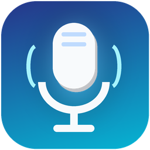

#  Voice Typer

A private, offline voice-typing app for Windows. Speak into Word, browsers, email, chat, and most other desktop apps. Voice Typer uses faster-whisper on your computer, adds punctuation, learns your writing style, and offers next-word suggestions.

## Features

- Local English speech recognition with no cloud audio upload
- Unicode-safe typing into Chrome, Brave, Word, email, chat, and other Windows apps—no browser extension required
- Optional local AI cleanup with Ollama for grammar, fillers, and false starts
- Selectable input microphone and adjustable silence patience
- Persistent settings and a personalized next-word model
- System tray mode, global hotkeys, and optional Windows startup
- Spoken punctuation, new lines, new paragraphs, and undo
- Built-in vocabulary editor and reload control
- Isolated installer, diagnostics, tests, and clean uninstall

## Install

1. Right-click `install.ps1` and choose **Run with PowerShell**.
2. Wait while the installer creates an isolated app environment and downloads the English speech model. The first install needs internet; everyday dictation does not.
3. Open **Voice Typer** from the desktop or Start Menu.

The app installs under `%LOCALAPPDATA%\VoiceTyper`. Your phrases, model, settings, and logs are separate under `%APPDATA%\Voice Typer`, so upgrades do not erase what the app learned.

## Use

1. Choose your microphone, or leave **Windows default microphone** selected.
2. Click inside the app where you want text to appear.
3. Press **Ctrl+Alt+Shift+L** and speak naturally. You can also click **Start dictating**; the control window hides to the tray.
4. Pause after each phrase. The patience slider controls how long silence lasts before transcription.
5. Press **Ctrl+Alt+Shift+L** again to pause.
6. Accept suggestions with **Ctrl+Alt+Shift+1**, **2**, or **3**.
7. Undo the most recent insertion with **Ctrl+Alt+Shift+Z**, or say **“undo that.”**
8. Close the window to keep Voice Typer in the system tray. Choose **Exit** in the tray menu or press **Ctrl+Alt+Shift+Q** to quit completely.

Enable **Start Voice Typer when I sign in to Windows** for tray startup at sign-in. Say **comma**, **period**, **question mark**, **new line**, or **new paragraph** for formatting. Recognition also supplies ordinary punctuation automatically.

## Chrome and Brave

Click any normal text field in Chrome or Brave and use the same global hotkey. Voice Typer sends Unicode text through Windows, so no extension, browser permission, or special profile is required. It works in standard fields and most rich-text editors; a website with elevated security restrictions may still block simulated input.

## Optional local AI cleanup

Standard dictation already works without AI cleanup. To enable grammar and filler-word cleanup:

1. Install [Ollama for Windows](https://ollama.com/download/windows).
2. Open PowerShell and run `ollama pull qwen2.5:1.5b-instruct`.
3. In Voice Typer, enable **Clean grammar, filler words, and false starts with Ollama**.

Voice Typer checks that the selected local model exists before enabling it. Cleanup sends only the recognized text to `127.0.0.1`, never to a cloud API. If Ollama is unavailable or returns an unsafe response, the original dictation is preserved and typed instead.

## Privacy and recognition

Speech is processed locally by the `base.en` Whisper model after its one-time download. Dictated phrases are stored only in your user data folder to improve predictions. There is no cloud speech request, telemetry, account, or background upload. Once downloaded, the model loads directly from its local cache without update checks. Optional AI cleanup is also local and disabled by default.

Select **Edit vocabulary** to add sentences containing technical names and unusual words, then choose **Reload vocabulary**. These examples become recognition hints and train next-word predictions. The app never uses fuzzy replacement to overwrite recognized words.

## Troubleshooting

- **No microphone:** Windows Settings → Privacy & security → Microphone → enable access and **Let desktop apps access your microphone**.
- **Wrong microphone:** Choose another input under **Audio & startup**; the app reinitializes it without restarting.
- **Nothing is typed:** Click a text field first. If the target app runs as administrator, Voice Typer must run at the same privilege level.
- **Slow first launch:** The initial model download can take a few minutes. Later launches are local.
- **A hotkey conflicts:** Close the other app using that shortcut or change the constants near the top of `voice_typer_app.py` and reinstall.
- **Logs and settings:** See `%APPDATA%\Voice Typer`.

For a dependency, microphone, and model check, run:

```powershell
& "$env:LOCALAPPDATA\VoiceTyper\.venv\Scripts\python.exe" "$env:LOCALAPPDATA\VoiceTyper\voice_typer.py" --diagnose
```

## Uninstall

Run `uninstall.ps1`. Shortcuts and program files are removed; your learned phrases and downloaded model are preserved by default. Add `-RemoveData` to delete those too.

## Development

Requires 64-bit Python 3.10–3.12 on Windows. Run tests with:

```powershell
python -m unittest discover -s tests -v
```
